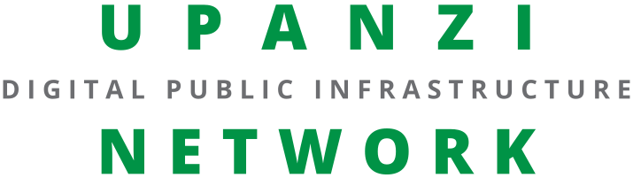

<div align="center">
<h1>Pepper Navigation</h1>
</div>

<div align="center">
  
</div>

Nav2 bringup for the Pepper robot: path planning, obstacle avoidance from 3D
point clouds (the Unitree L2 and the bottom RealSense), an independent
collision-monitor safety layer, and the saved maps those consume. Localization
is a launch-time profile; the default is `fastlio_localization`, which
registers the live scan against a prior 3D map inside FAST-LIO's filter.

## ✨ Key Features
- **ROS2 Native**: Built for ROS2 Humble and Nav2
- **Localization profiles**: fastloc (default), pointloc, RTAB-Map and AMCL, chosen at launch time
- **3D obstacle avoidance**: voxel-layer costmaps built from the Unitree L2 and the bottom RealSense
- **Independent safety layer**: a collision monitor sits between the controller and the base
- **Localization watchdog**: holds navigation while localization is lost, and re-arms the search

## ✅ Prerequisites

- **ROS 2 Humble**
- **`pepper_slam`** built in the same workspace (supplies the sensor-rig static
  TF, and `rtabmap_base.launch.py` for the RTAB-Map profile)
- **`fast_lio`** built in the same workspace (odometry for every profile, and
  the `fastlio_localization` node the default profile runs)
- **Unitree L2 lidar** publishing `/points` and `/imu/data` via `l2lidar_node`.
  No launch file here starts it, and nothing works without it
- **`naoqi_driver2`** on the robot, if it should actually move: it consumes the
  `/cmd_vel` this package produces

## 🛠️ Installation

```bash
sudo apt install \
  ros-humble-nav2-bringup \
  ros-humble-nav2-collision-monitor \
  ros-humble-pointcloud-to-laserscan

cd ~/ros2_ws
colcon build --packages-select pepper_slam pepper_navigation
source install/setup.bash
```

`pointcloud-to-laserscan` is only needed by the AMCL profile.

## 🚀 Running

### 1. Start the sensors

No launch file in this package starts a driver.

```bash
source ~/ros2_ws/install/setup.bash

# L2 lidar + bottom RealSense together (each has an enable_* argument).
# Does not start naoqi_driver.
ros2 launch dec_launch dec_robot.launch.py

# The robot itself, if it should drive
ros2 launch dec_launch naoqi_driver.launch.py nao_ip:=<robot-ip>
```

The RealSense is required for the default fastloc profile: it is the **only**
obstacle source of that profile's local costmap (see [Costmaps](#-costmaps)).
It is also required for RTAB-Map, which subscribes to RGB. On pointloc and
AMCL it is a second, dense forward source next to the L2 and the local costmap
still works without it.

### 2. Bring up navigation

The default profile:

```bash
ros2 launch pepper_navigation pepper_nav2_fastloc.launch.py
```

`fastlio_localization` finds its own initial pose with ScanContext, so no
`/initialpose` is needed. It requires two maps of the same environment: the
per-keyframe clouds and poses it registers against (`map_scan_dir`,
`map_pose_file`), and the 2D grid `map_server` publishes for the global
costmap (`map`). All three default to the files shipped in this package, with
one catch:

> `map_scan_dir` defaults to `pcd/sc_pcd_20260823/`. Those clouds are
> gitignored (75 MB) and **are not in a fresh checkout**; copy them in first.
> Without them `fastlio_localization` fails `on_configure`, nothing publishes
> `map -> base_footprint`, and the whole Nav2 bringup sits inactive with no
> other symptom.

Every profile opens RViz with a matching config (`rviz:=false` for headless)
and accepts `use_sim_time:=true` for bag replay.

### Other profiles

All profiles share the same global costmap, controller tuning and safety
layer, so switching profile mostly changes what corrects the odometry drift.
The exception is the local costmap: fastloc feeds it from the RealSense only,
the others from the L2 and the RealSense (see [Costmaps](#-costmaps)).

| Launch file | Localization | Needs | Initial pose |
|---|---|---|---|
| `pepper_nav2_fastloc.launch.py` *(default)* | `fastlio_localization`: prior map inside FAST-LIO's iEKF | keyframe clouds + `pose.json`, plus a 2D grid | automatic (ScanContext) |
| `pepper_nav2_pointloc.launch.py` | `pointlio_localization`: the Point-LIO equivalent | same as fastloc | automatic |
| `pepper_nav2_rtabmap_loc.launch.py` | RTAB-Map localization mode | an RTAB-Map `.db` via `database_path:=`, and RGB | RViz **2D Pose Estimate** |
| `pepper_nav2_amcl.launch.py` | AMCL over a flattened `/scan`, on FAST-LIO odom | a 2D grid via `map:=` | RViz **2D Pose Estimate** |

For the AMCL profile, if the particle cloud never tightens, the flattening
height band is the first thing to adjust:

```bash
ros2 launch pepper_navigation pepper_nav2_amcl.launch.py \
    scan_min_height:=0.30 scan_max_height:=1.20
```

### Bag replay

```bash
ros2 launch pepper_navigation pepper_nav2_fastloc.launch.py use_sim_time:=true
ros2 bag play <bag> --clock --topics /points /imu/data
```

Nav2 will localize and build costmaps, but a bag cannot react to `cmd_vel`;
driving to a goal needs the real robot.

### Tuning the costmaps on a bag

`launch/bag_test/costmap_bag.launch.py` runs only the two costmaps (no
controller goal, no robot) plus tools that show why each point is or is not
marked. Its docstring lists every argument and the exact `ros2 bag play`
flags per bag type.

```bash
# Bag without a recorded pose: FAST-LIO localizes it (the defaults)
ros2 launch pepper_navigation costmap_bag.launch.py

# Bag that already carries map -> base_footprint
ros2 launch pepper_navigation costmap_bag.launch.py localize:=false depth_images:=false

# A/B test against a copy of the params
ros2 launch pepper_navigation costmap_bag.launch.py params_file:=/path/to/copy.yaml
```

With `localize:=true`, nothing is drawn until FAST-LIO reports a lock (about
25 s of replay). `config/nav2_params_l2voxel_test.yaml` is a ready-made
`params_file` that puts the L2 back into the local costmap as a voxel layer.

To see what the collision monitor would count, without Nav2 running:

```bash
python3 utils/collision_zone_viewer.py
rviz2 -d utils/collision_zone_viewer.rviz
```

### Watching from a laptop

`rviz_remote.launch.py` starts RViz alone with a config that subscribes to no
point clouds, camera or prior map, for watching a stack that runs on the
robot over WiFi. Its docstring covers the CycloneDDS discovery setup that has
to be right for it to see anything.

## 🖥️ ROS Interface

Standard Nav2 interfaces (`/navigate_to_pose`, `/map`, `/plan`, the costmaps,
`/initialpose`) are not repeated here.

### Subscribed Topics

| Topic | Type | Notes |
|---|---|---|
| `/points` | `sensor_msgs/PointCloud2` | L2 cloud; the global costmap's obstacle source, and the local one's except on fastloc |
| `/camera/depth/color/points` | `sensor_msgs/PointCloud2` | RealSense depth; local costmap only, and its only source on fastloc |

### Published Topics

| Topic | Type | Notes |
|---|---|---|
| `/cmd_vel` | `geometry_msgs/Twist` | Collision-monitor-gated velocity, consumed by `naoqi_driver2` |
| `/cmd_vel_raw` | `geometry_msgs/Twist` | Controller and behavior output, before the collision monitor. **Not** what the robot drives on |
| `/collision_monitor_state` | `nav2_msgs/CollisionMonitorState` | Active safety action: none, slowdown or stop |
| `/polygon_stop`, `/polygon_slowdown` | `geometry_msgs/PolygonStamped` | Safety zones, 0.40 m and 0.80 m |
| `/localization/overlap` | `std_msgs/Float32` | fastloc / pointloc: fraction of the live scan on the prior map, 1 Hz |

### Internal Topics

Published and consumed inside the stack; listed for debugging.

| Topic | Type | Producer → consumer |
|---|---|---|
| `/tf_nav` | `tf2_msgs/TFMessage` | `tf_nav_relay` → the Nav2 servers (see [`/tf_nav`](#tf_nav)) |
| `/points_safety` | `sensor_msgs/PointCloud2` | `points_safety_filter` → `collision_monitor` |
| `/points_costmap` | `sensor_msgs/PointCloud2` | `points_costmap_filter` → both costmaps, AMCL profile only |
| `/scan` | `sensor_msgs/LaserScan` | `pointcloud_to_laserscan` → `amcl`, AMCL profile only |

### Services

| Name | Type | Notes |
|---|---|---|
| `/localization_recover` | `std_srvs/Trigger` | "I am lost": same call on every profile, dispatched to the running backend |
| `/relocalize` | `std_srvs/Trigger` | fastloc / pointloc: re-arm the ScanContext search from scratch |

## 🎯 Sending goals

In RViz, use the **Nav2 Goal** tool. From the command line:

```bash
ros2 action send_goal /navigate_to_pose nav2_msgs/action/NavigateToPose \
  "{pose: {header: {frame_id: 'map'}, pose: {position: {x: 2.0, y: 1.0}, orientation: {w: 1.0}}}}"
```

`ros2 run pepper_navigation send_goal` sends one fixed goal from
`src/tools/send_goal.cpp`; edit the coordinates there and rebuild.

## 🔌 Docking

Docks Pepper onto its official charging station with
[opennav_docking](https://github.com/open-navigation/opennav_docking)'s docking
server, running next to any Nav2 profile. Nav2 drives to a staging pose in
front of the station; `dock_detector` measures where the station really is
(it may have been nudged from its map pose) with the L2 and the bottom camera;
the robot turns around, backs on blind, and stops when NAOqi reports it plugged
in. The sequence and the geometry are documented in `config/docking.yaml`.

One-time setup:

1. opennav_docking's humble branch, from source. The apt release (0.0.2) has
   no `rotate_to_dock`, and `pepper_docking.launch.py` refuses to run with it.
   ```bash
   cd ~/ros2_ws/src
   git clone -b humble https://github.com/open-navigation/opennav_docking.git
   git -C opennav_docking checkout 9d7819a
   touch opennav_docking/opennav_following/COLCON_IGNORE \
     opennav_docking/opennav_following_bt/COLCON_IGNORE \
     opennav_docking/opennav_following_demo/COLCON_IGNORE
   cd ~/ros2_ws
   rosdep install --from-paths src --ignore-src -r -y     # nav2_graceful_controller
   colcon build --symlink-install --packages-select \
     opennav_docking_msgs opennav_docking_core opennav_docking pepper_navigation
   ```
2. The bottom camera: start the driver with
   `ros2 launch dec_launch naoqi_driver.launch.py bottom_camera:=true`. This
   needs naoqi_driver2's boot-config parameters (`feature/modern-cpp`); on
   `master`, enable `converters.bottom_camera` (resolution 2) in its
   `share/boot_config.json` instead.
3. The station's docked pose in `config/docks.yaml`, measured once
   (`TEST_PLAN_docking.md`, test 3). It ships as NaN, and the launch file
   refuses to start until it is set.

Running:

```bash
ros2 launch pepper_navigation pepper_nav2_fastloc.launch.py
ros2 launch pepper_navigation pepper_docking.launch.py    # odom_topic:=/odom_lio for amcl, kissicp, rtabmap_loc

# Overt attention off, head still and pitched down so the bottom camera sees the station
ros2 topic pub --once /joint_angles naoqi_bridge_msgs/msg/JointAnglesWithSpeed \
  "{joint_names: [HeadYaw, HeadPitch], joint_angles: [0.0, 0.2], speed: 0.1}"

ros2 action send_goal /dock_robot opennav_docking_msgs/action/DockRobot \
  "{use_dock_id: true, dock_id: home_dock}" --feedback
ros2 action send_goal /undock_robot opennav_docking_msgs/action/UndockRobot \
  "{dock_type: pepper_station}"
```

| Topic | Type | |
|---|---|---|
| `/dock_robot`, `/undock_robot` | `opennav_docking_msgs` actions | dock at `home_dock`; drive back off it |
| `/detected_dock_pose` | `geometry_msgs/PoseStamped` | the fused station pose the docking server backs onto |
| `/dock_detector/status` | `std_msgs/String` | what each sensor sees, and how far the station is from its map pose |
| `/dock_detector/camera_debug` | `sensor_msgs/Image` | the bottom camera with the white blob (green), the map's pose (orange) and the measured one (red) |
| `/dock_detector/lidar_pose`, `/dock_detector/camera_pose` | `geometry_msgs/PoseStamped` | each sensor on its own |
| `/battery_state` | `sensor_msgs/BatteryState` | Pepper's battery, from naoqi_driver's `/diagnostics` |
| `/docking/battery_state` | `sensor_msgs/BatteryState` | plugged in as +1 A / -1 A: what the docking server reads as "charging" |

## 🧭 Frames

Who publishes what, per profile. The local costmap rolls in the odometry frame
and the global costmap lives in `map`:

| Profile | `map -> odom` | `odom -> base_footprint` | Local costmap frame |
|---|---|---|---|
| fastloc / pointloc | the localizer publishes `map -> base_footprint` directly; there is no `odom` edge | | `map` |
| rtabmap_loc | `rtabmap` | `lio_odom_bridge` (FAST-LIO) | `odom` |
| amcl | `amcl` | `lio_odom_bridge` (FAST-LIO) | `odom` |

The static sensor chain (`base_footprint -> l2lidar_frame -> cameras`) comes
from `pepper_slam`'s `pepper_sensor_tf.launch.py`, which every profile nests.
**Exactly one node may own `map -> odom`**: the AMCL and RTAB-Map profiles run
FAST-LIO with `bridge_level_frame:=false` so the bridge's own `odom -> odom`
edge does not give `odom` a second parent. Wheel odometry is `pepper_odom`,
never `odom`: plain `odom` belongs to the LIO sources, and a second publisher
would silently overwrite it.

### `/tf_nav`

`tf_nav_relay` republishes on `/tf_nav` only the transforms whose parent is
`map`, `odom`, `lio_init` or `base_footprint`, leaving out Pepper's joint tree
(about 4000 transforms/s, enough to stall the local costmap). The Nav2 servers
and `collision_monitor` listen to `/tf_nav`; TF broadcasters, `/tf_static` and
RViz use the normal topics.

## 🧱 Costmaps

| Costmap | Profile | Layers | Obstacle sources |
|---|---|---|---|
| Global (`map`) | all | static, voxel, inflation | L2 |
| Local (rolling, 10 x 10 m) | fastloc | voxel, inflation | RealSense only |
| Local | pointloc, amcl, rtabmap_loc | voxel, inflation | L2 and RealSense |

The L2 source is `/points`, except on AMCL, where both costmaps read
`/points_costmap`: the L2 cloud with the near range and the ground plane
removed by a second `cloud_range_filter` (`points_costmap_filter`).

On fastloc the local costmap is blind outside the camera cone (about
+/-29 deg, from about 0.35 m). The L2 still feeds the global costmap and the
collision monitor, so a close obstacle anywhere around the robot still stops
it. To put the L2 back, enable `l2_voxel` in `nav2_params_fastloc.yaml`.

## 🛡️ Safety layer

Nothing reaches the wheels unvetted:

```
controller_server ─┐
                   ├─> /cmd_vel_raw ──> collision_monitor ──> /cmd_vel ──> naoqi_driver2
behavior_server  ──┘                          ^
                                     /points_safety
```

`collision_monitor` slows to 30 % inside 0.80 m and stops inside 0.40 m when
more than 3 points fall in a zone, independently of the costmaps and the
planner. It reads `/points_safety`, the L2 cloud without the lidar's own
housing (`points_safety_filter`); otherwise those self-hits would stop the
robot for good. `utils/collision_zone_viewer.py` shows what it counts without
Nav2 running (see [Tuning the costmaps on a bag](#tuning-the-costmaps-on-a-bag)).

## 🔁 Losing localization

fastloc and pointloc re-score the live scan against the prior map at 1 Hz,
because a wrong-but-confident lock has no other symptom. Sustained low overlap
re-arms the search automatically, and `localization_watchdog` cancels the
active goal for as long as it lasts. Only sustained badness counts; a single
low reading is normal when turning into unmapped space or when someone walks
through the scan. Pass `watchdog:=false` to monitor without holding
navigation.

```bash
ros2 service call /localization_recover std_srvs/srv/Trigger   # any profile
ros2 topic echo /localization/overlap                          # fastloc health
```

## 🗺️ Saving a new map

With a `pepper_slam` mapping session running:

```bash
ros2 run nav2_map_server map_saver_cli -f ~/maps/my_new_map
ros2 launch pepper_navigation pepper_nav2_amcl.launch.py map:=~/maps/my_new_map.yaml
```

The profiles take an absolute `map:=` path, so a map does not have to live in
the package.

## 📁 Package Structure

```
pepper_navigation/
├── config/
│   ├── nav2_params_fastloc.yaml        # Nav2 params, fastloc profile (default)
│   ├── nav2_params_pointloc.yaml       # Nav2 params, pointloc profile
│   ├── nav2_params_rtabmap_loc.yaml    # Nav2 params, RTAB-Map profile
│   ├── nav2_params_amcl.yaml           # Nav2 params, AMCL profile
│   ├── nav2_params_l2voxel_test.yaml   # fastloc with the L2 as a local voxel layer; bag tests only
│   ├── docking.yaml                    # docking server, dock_detector and battery relay
│   └── docks.yaml                      # the charging station's docked pose in the map
├── launch/
│   ├── pepper_nav2_fastloc.launch.py   # Nav2 + fastlio_localization (default)
│   ├── pepper_nav2_pointloc.launch.py  # Nav2 + pointlio_localization
│   ├── pepper_nav2_rtabmap_loc.launch.py # Nav2 + RTAB-Map localization
│   ├── pepper_nav2_amcl.launch.py      # Nav2 + AMCL on FAST-LIO odom
│   ├── rviz_remote.launch.py           # RViz only, for a laptop watching the robot
│   ├── odom_test.launch.py             # odometry-only bringup with a path publisher
│   ├── pepper_docking.launch.py        # docking server + dock_detector + battery relay
│   └── bag_test/
│       └── costmap_bag.launch.py       # the two costmaps on a recorded bag, for tuning
├── map/
│   ├── pepper_map_lc.yaml / .pgm       # the 2D grid every profile's map_server defaults to
│   └── *.png                           # map preview renders
├── pcd/
│   ├── sc_pose_20260823.json           # per-keyframe poses for fastloc / pointloc
│   ├── pepper_map_lc_poses.txt         # the PGO run's trajectory
│   └── sc_pcd_20260823/                # matching keyframe clouds; gitignored, copy in
├── rviz/                               # one config per profile, plus voxel, remote and bag-test views
├── scripts/
│   ├── wait_for_map_then_start.py      # starts Nav2 once map -> base_footprint exists
│   ├── localization_watchdog.py        # cancels goals while the localizer reports lost
│   ├── localization_recovery.py        # /localization_recover, dispatched per backend
│   ├── dock_detector.py                # node: station pose from the L2 and the bottom camera
│   ├── dock_perception.py              # its geometry and vision, without ROS
│   ├── naoqi_battery_state.py          # /diagnostics -> battery_state, docking/battery_state
│   └── cloud_delay.py, costmap_explain.py, depth_to_cloud.py, points_to_image.py  # costmap_bag helpers
├── utils/
│   └── collision_zone_viewer.py/.rviz  # what the collision monitor counts; run by hand
├── src/
│   ├── tf_nav_relay.cpp                # /tf without Pepper's joint tree, on /tf_nav
│   └── tools/
│       ├── send_goal.cpp               # one-shot goal sender
│       └── odom_path_publisher.cpp     # traversed path for RViz
├── test/
│   ├── test_shared_nav2_params.py      # guards the params blocks shared across profiles
│   ├── test_dock_perception.py         # station detection on ray-cast scans and images
│   ├── test_docking_config.py          # docking geometry, wiring and the battery relay
│   ├── test_docking_sim_launch.py      # docking end to end against a simulated Pepper
│   └── dock_sim.py, docking_world.py   # the ray caster and simulated world they use
├── CMakeLists.txt
├── package.xml
└── README.md
```

## 🧪 Testing

```bash
cd ~/ros2_ws
colcon test --packages-select pepper_navigation
colcon test-result --verbose
```

Besides the linters, this runs `test/test_shared_nav2_params.py`, which fails
if `behavior_server`, `controller_server` or `planner_server` differ between
the nav2 param files. It also runs standalone:
`python3 test/test_shared_nav2_params.py`.

The docking tests need no robot:

- `test_dock_perception.py`: the lidar and the bottom camera each find the
  station within 1.5 cm and 1 degree on scenes ray-cast from Pepper's real
  sensor poses (moved station, white wall behind it, legs beside it, dim
  light), and refuse a missing, too distant, wrongly sized or hidden one.
- `test_docking_config.py`: the staging pose puts the L2 0.6 m from the
  station and the bottom camera sees all of it; the server turns around,
  backs in and ignores the station as an obstacle; the files agree.
- `test_docking_sim_launch.py`: the real `pepper_docking.launch.py` against
  `test/docking_world.py`, a simulated Pepper and a station moved 12 cm and
  8 degrees from its map pose. Docks, checks the robot is square on the true
  contacts, undocks. Runs on a private ROS domain and refuses to send a goal
  if any other node is visible. Registered only once opennav_docking is built;
  `DOCKING_SIM_SHIFT="along,across,degrees"` tries other station shifts.

## 🔧 Troubleshooting

| Symptom | Likely cause and check |
|---|---|
| Nav2 never becomes active, no error | fastloc: keyframe clouds missing, so no lock. Check `pcd/sc_pcd_20260823/` exists and `ros2 lifecycle get /controller_server` |
| Costmaps empty, no plan | `/points` not flowing: `ros2 topic hz /points` (and `/imu/data`) |
| fastloc: local costmap empty, obstacles ignored | The RealSense is not running: `/camera/depth/color/points` is the local costmap's only source |
| Local costmap stops updating after a while | The Nav2 nodes are on the full `/tf`: check `ros2 topic hz /tf_nav` |
| Goal active but the robot does not move | `/cmd_vel_raw` flows but `/cmd_vel` is zero: the collision monitor is stopping it (`ros2 topic echo /collision_monitor_state`). If it never clears, check `/points_safety` exists |
| `map -> odom` jitter or TF warnings | Two publishers of one transform: check `bridge_level_frame`, and `ros2 run tf2_ros tf2_echo map base_footprint` |
| AMCL particles never tighten | Flattened `/scan` does not match the grid: retune `scan_min_height` / `scan_max_height` |
| Global costmap all unknown | `/map` never arrived: wrong `map:=` path, or `map_server` never activated |
| `pepper_docking.launch.py`: "has no rotate_to_dock" | opennav_docking is the apt release: build its humble branch (see Docking) |
| `pepper_docking.launch.py`: "home_dock has no pose" | Measure the docked pose into `config/docks.yaml` (`TEST_PLAN_docking.md`, test 3) |
| Docking fails with 904 (FAILED_TO_DETECT_DOCK) | `ros2 topic echo /dock_detector/status`: "robot moving" (it measures only standing still), "no white blob" (head pitch, overt attention, `/naoqi_driver/camera/bottom/image_raw`), "not found" (station moved more than `max_shift`) |
| Docking fails with 906 (FAILED_TO_CHARGE) | Backed on but never plugged in: `ros2 topic echo /docking/battery_state`, then recheck `station_offset` (`TEST_PLAN_docking.md`, test 3) |

## 💡 Support

For issues or questions:
- Create an issue on the [pepper4dec GitHub repository](https://github.com/yohatad/pepper4dec/issues)
- Contact: <a href="mailto:yohatad123@gmail.com">yohatad123@gmail.com</a>

## 📜 License
Copyright (C) 2025 Carnegie Mellon University Africa
Licensed under the BSD-3-Clause License. See individual package licenses for details.
